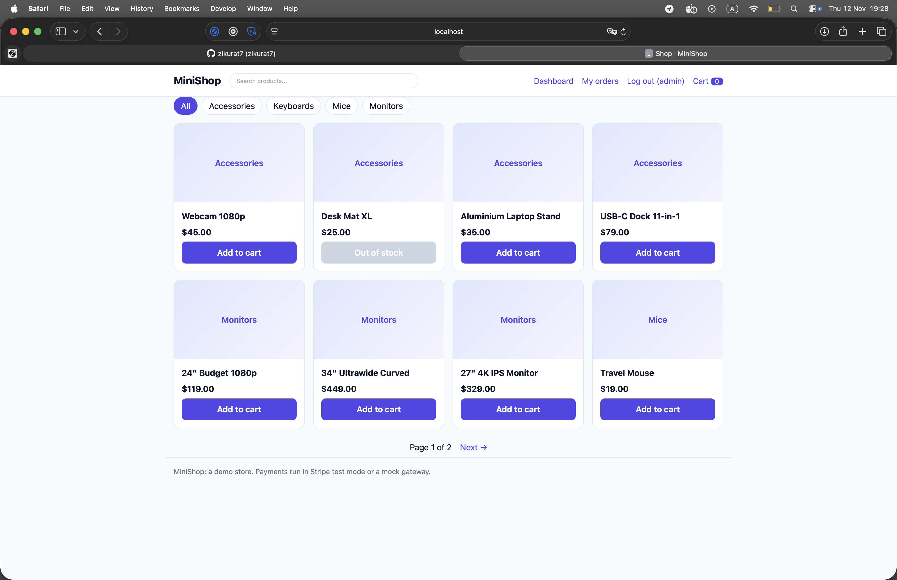
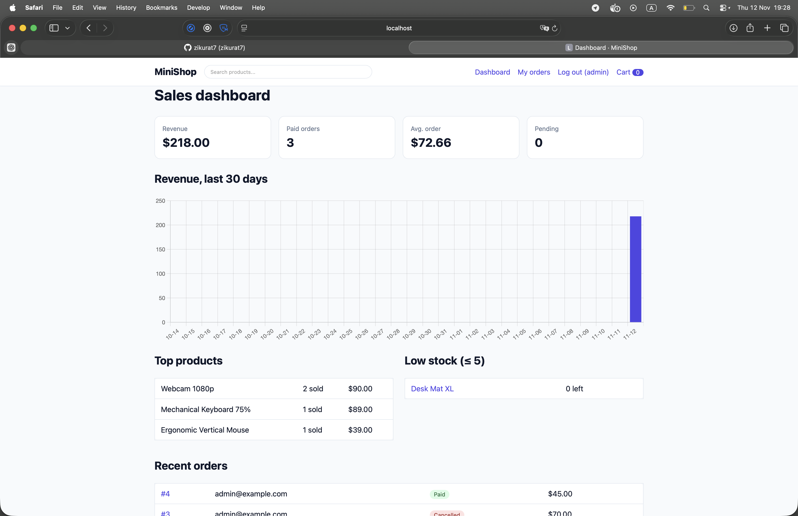
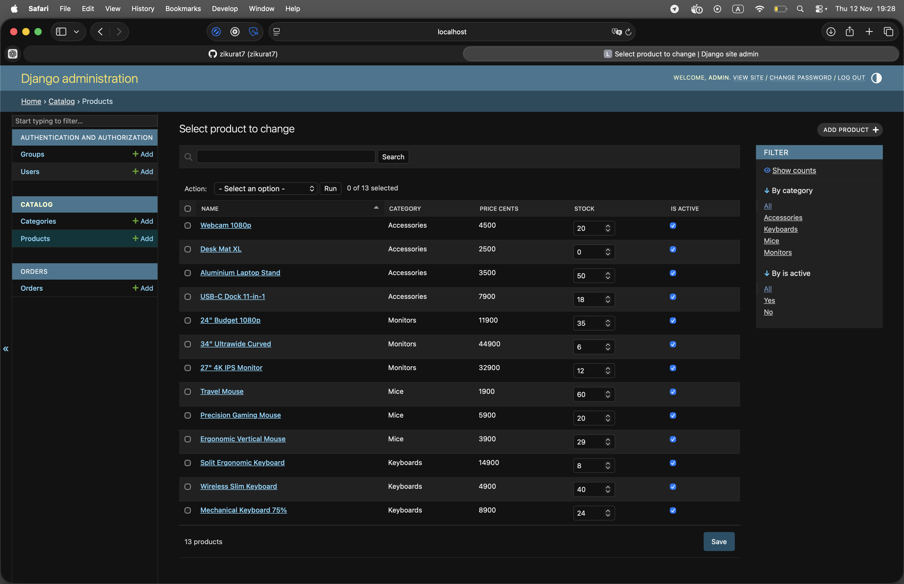

# MiniShop

A small e-commerce app I built to practice the full stack in Python: product catalog, cart, checkout with Stripe, a REST API and a sales dashboard. It's built on Django 6 and Python 3.15, and I tried to build it the way I'd want to on a real team: typed, tested, containerised and with CI.

I picked an online shop because everyone understands the domain, and it has some problems I find interesting. Two people can't buy the last item, money can't be handled with floats, and payment webhooks arrive late or twice.

## Screenshots

### Homepage


### Dashboard


### Django admin



## What it does

- **Storefront**: browse, search, filter by category and paginate. The cart updates without a page reload using HTMX.
- **Checkout**: guests can check out, and users can sign up and see their order history. Payment goes through **Stripe Checkout** in test mode. With no Stripe keys it falls back to a **mock payment page**, so you can run the whole flow without an account.
- **REST API** under `/api/` with auto-generated OpenAPI docs at `/api/docs/`. Products and categories are public, and placing orders needs auth.
- **Sales dashboard** at `/dashboard/` for staff: revenue chart for the last 30 days, top products, low-stock alerts and recent orders.
- **Django admin** to manage products and orders.

## Stack

| | |
|---|---|
| Language | Python 3.15 |
| Backend | Django 6, Django REST Framework, drf-spectacular |
| Database | PostgreSQL (SQLite for quick local dev) |
| Frontend | Django templates + HTMX, Chart.js for the dashboard |
| Payments | Stripe Checkout + webhooks |
| Tooling | uv, pytest, Ruff, Docker Compose, GitHub Actions |

I went with server-rendered templates and HTMX over a separate React app. For a shop like this it's much less code, there's no duplicated validation between frontend and backend, and the cart still feels instant.

## Run it

**With Docker** (Postgres + the app, nothing else needed):

```bash
cd /Users/zikuratpp/Documents/propro/minishop
docker compose up --build

builds the app and starts it, along with its database, at localhost:8000. The site is empty at this point. 


cd /Users/zikuratpp/Documents/propro/minishop
docker compose exec web python manage.py seed_demo

fills the empty shop with sample products and creates the admin / admin login. Run it once, in a second terminal.
```

Then open http://localhost:8000. The seed command creates sample products and an admin user (`admin` / `admin`, for local demo only).

**Without Docker** (uses SQLite):

```bash
uv sync
cp .env.example .env
uv run --env-file .env python manage.py migrate
uv run --env-file .env python manage.py seed_demo
uv run --env-file .env python manage.py runserver
```

**Tests and linting:**

```bash
uv run pytest --cov
uv run ruff check . && uv run ruff format --check .
```

There are 70+ tests. One of them hammers the checkout from 10 threads against Postgres to prove the stock never goes negative. It's skipped on SQLite and runs in CI.

### Using real Stripe (optional)

1. Put your test key in `.env` as `STRIPE_SECRET_KEY=sk_test_...`.
2. Forward webhooks: `stripe listen --forward-to localhost:8000/orders/webhook/stripe/`.
3. Copy the `whsec_...` secret it prints into `STRIPE_WEBHOOK_SECRET`.
4. Pay with the test card `4242 4242 4242 4242`, any future date and any CVC.

## Design decisions

These are the bits I spent the most time thinking about.

**Money is stored as integer cents.** Floats get rounding errors, and Stripe wants integer cents anyway. A `Decimal` property and a template filter handle display.

**Stock is reserved when the order is created, not when it's paid.** `create_order` runs in a transaction and locks the product rows with `select_for_update` (in primary-key order, so concurrent checkouts can't deadlock). If any item is short, the whole transaction rolls back. If the order is cancelled or expires unpaid, the stock goes back (`expire_orders` command, meant to run from cron).

**Webhooks are idempotent.** Stripe retries, so `mark_paid` can be called any number of times safely. The webhook verifies Stripe's signature before doing anything. The success page also asks Stripe directly if the order is paid, in case the redirect beats the webhook.

**Order lines snapshot the name and price.** If I change a product's price later, old orders don't change.

**Prices never live in the session.** The cart only stores `{product_id: quantity}` and looks prices up from the database every time, so a stale or tampered session can't change what someone pays.

**Order URLs use a UUID**, not an integer id, so nobody can walk through `/orders/1`, `/orders/2`... and read other people's orders.

**Business logic lives in `orders/services.py`**, not in views. The HTML views and the REST API both call the same functions, so the rules exist in one place.

**Payments sit behind a small gateway interface** (`StripeGateway` / `MockGateway`), so the app doesn't care which one is active, and tests don't need the network.

## Project layout

```
config/      settings, root urls
catalog/     Category, Product, storefront views, seed command
cart/        session cart + HTMX views
orders/      Order, OrderItem, services (the core logic), payments, webhook
accounts/    signup / login
api/         DRF serializers, viewsets, OpenAPI
dashboard/   staff sales dashboard
tests/       pytest suite
```

## API quick look

```bash
curl 'localhost:8000/api/products/?category=keyboards&in_stock=true&ordering=price_cents'

curl -u admin:admin -X POST localhost:8000/api/orders/ \
  -H 'Content-Type: application/json' \
  -d '{"items": [{"product": 1, "quantity": 2}]}'
```

The order response includes a `checkout_url` to send the customer to. If an item is out of stock, you get a `409`.

## What I'd do next

- Background jobs (Celery or ARQ) for order confirmation emails and for expiring orders, instead of a cron command.
- Product images with upload and a CDN rather than image URLs.
- Refunds and partial shipments.
- Caching the catalog with Redis, and an API token auth option.
